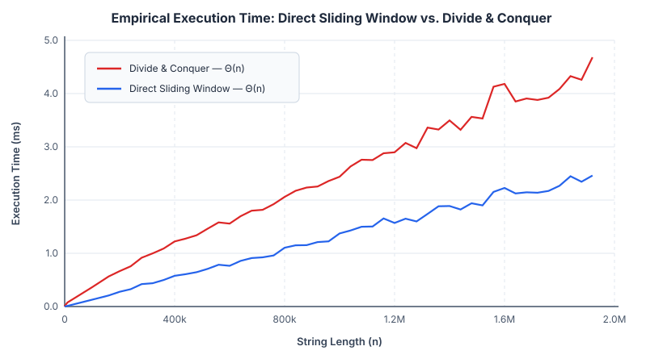

# Algorithm Design & Empirical Performance Analysis in C++

**Author:** Pedro Villa Navarro  
**Language & Standard:** ISO C++17 (`-Wall -Wextra -Wpedantic -O3`)  

---

## Overview

This repository contains the C++ implementations, validation suites, and empirical performance studies developed for the *Algorithms and Data Structures II* (*Algoritmos y Estructuras de Datos II*) coursework. It explores three fundamental algorithmic paradigms from both a theoretical complexity perspective and an empirical, hardware-aware execution perspective:

1. **[Module 01 — Divide & Conquer vs. Direct Sliding Window](./01-divide-and-conquer/)**:
   - **Problem**: Maximum substring ASCII difference over strings of length $n$ ($n \le 1.92 \times 10^6$) with window length $m$.
   - **Focus**: Mathematical recurrence analysis ($\Theta(n)$), differential fuzz testing across 1,000 randomized inputs, and microarchitectural comparison of recursive Divide & Conquer against a single-pass sequential Sliding Window.
2. **[Module 02 — Greedy Algorithms & Backtracking](./02-greedy-and-backtracking/)**:
   - **Greedy (`arD.cpp`)**: Unit-time task scheduling with deadlines and profits (*Aircraft Landing Scheduling*), achieving $O(A \log A + A \cdot \min(Ut, A))$ time via matroid greedy-choice optimality.
   - **Backtracking (`backE.cpp`)**: Exact combinatorial solver for the NP-hard *Maximum Diversity Problem* (*Heavy $m$-Subgraph*), implementing an iterative state-space decision tree with incremental objective evaluation and cardinality pruning.

---

## Key Systems & Performance Insights

A central takeaway of [Module 01](./01-divide-and-conquer/README.md) is the empirical divergence between two algorithms that share the exact same asymptotic time complexity $\Theta(n)$:

| Input Size ($n$) | Window ($m$) | Direct Sliding Window (ms) | Divide & Conquer (ms) | Speedup Factor |
| ---: | ---: | ---: | ---: | ---: |
| $10,000$ | $10$ | $0.01276$ | $0.07502$ | $5.88\times$ |
| $100,000$ | $100$ | $0.12914$ | $0.36436$ | $2.82\times$ |
| $520,000$ | $520$ | $0.70780$ | $1.46230$ | $2.07\times$ |
| $1,000,000$ | $1,000$ | $1.37258$ | $2.43740$ | $1.78\times$ |
| $1,920,000$ | $1,920$ | $2.46112$ | $4.68250$ | $1.90\times$ |



Although the Divide & Conquer recurrence $T(n) = 2T(n/2) + \Theta(m)$ resolves to $\Theta(n)$ for fixed $m$, the iterative Sliding Window is consistently **$\sim 1.9\times$ faster** on large inputs due to:
1. **Zero Call-Stack Overhead**: Avoids $O(n/m)$ recursive function calls, stack-frame allocations, and register spills.
2. **Strict Sequential Locality**: Performs a single linear pass over contiguous memory (`std::vector<int>`), maximizing L1 data cache hit rates and hardware stride prefetcher efficiency without re-scanning boundary regions (`[puntoMedio - m + 1, puntoMedio + m)`).

---

## Repository Structure

```text
aed2-algorithms-cpp/
├── Makefile                                   # GNU Make build & automated test suite
├── CMakeLists.txt                             # Cross-platform CMake configuration
├── 01-divide-and-conquer/
│   ├── README.md                              # Complexity proofs, recurrences & benchmark plots
│   ├── src/
│   │   ├── dyv.cpp                            # Recursive Divide & Conquer solver
│   │   ├── resolucionDirecta.cpp              # Linear O(n) Sliding Window solver
│   │   └── generadorChar.cpp                  # Random test case generator
│   ├── scripts/
│   │   ├── exec.sh                            # Single-run execution comparison script
│   │   └── execValidacion.sh                  # 1,000-run differential fuzzing harness
│   └── benchmark/
│       ├── dyvTiempo.cpp                      # POSIX gettimeofday() instrumented D&C solver
│       ├── resolucionDirectaTiempo.cpp        # POSIX gettimeofday() instrumented Direct solver
│       ├── generadorCharTiempo.cpp            # Parameterized benchmark input generator
│       ├── execTiempo.sh                      # 50-size x 20-iteration benchmark automation
│       └── data/
│           ├── ejemploTiemposSalida.txt       # Raw experimental dataset (50 input sizes)
│           └── tiempos_grafica.svg            # Empirical execution time plot (SVG)
└── 02-greedy-and-backtracking/
    ├── README.md                              # Theoretical analysis of Greedy & Backtracking
    ├── greedy/
    │   ├── src/arD.cpp                        # Greedy Aircraft Landing Scheduler
    │   └── benchmark/
    │       ├── vorazDtiempos.cpp              # Instrumented Greedy benchmark
    │       └── execVorazDtiempos.sh           # Greedy scaling benchmark script
    └── backtracking/
        ├── src/backE.cpp                      # Iterative Backtracking solver (Max Diversity)
        └── benchmark/
            ├── backEtiempos.cpp               # Instrumented Backtracking benchmark
            └── execBackEtiempos.sh            # Exponential scaling benchmark (n = 2..24)
```

---

## Building and Running Tests

### Using `Make` (Linux / macOS / WSL)

```bash
# Compile all solvers, generators, and benchmarks with -std=c++17 -O3 -Wall -Wextra -Wpedantic
make all

# Run the automated verification suite (differential & functional tests)
make test

# Clean build artifacts
make clean
```

### Using `CMake` (Linux / macOS / Windows)

```bash
cmake -B build -DCMAKE_BUILD_TYPE=Release
cmake --build build
```

## Collaborators

- **Marta Tomás** ([@MartaTR13](https://github.com/MartaTR13))
- **Pedro Villa** ([@pedro-villa](https://github.com/pedro-villa))
